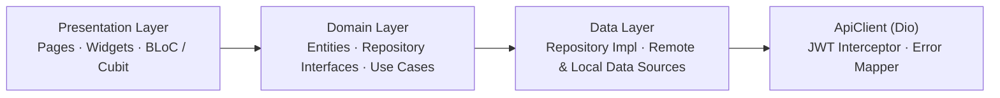
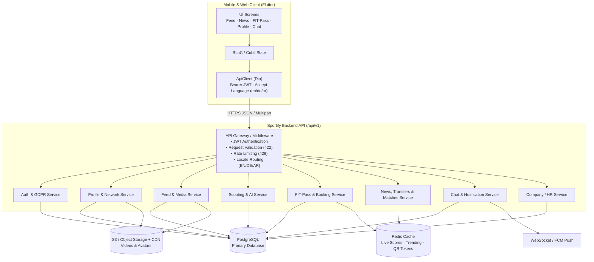

# ⚽ Sportify Mobile (`sportify-mobile`)

> **The LinkedIn-Style Professional Football Scouting, Highlights, Live Transfers & FIT-Pass Platform**  
> Built with **Flutter 3.29 · Clean Architecture · BLoC / Cubit · GetIt DI · GoRouter · Trilingual (`EN` / `DE` / `AR`)**

[](https://github.com/MustafaAmmarD/sportify-mobile/actions/workflows/deploy-web.yml)

---

## 🌐 Live Interactive Demo

👉 **Launch Live Demo in Browser:** **[https://mustafaammard.github.io/sportify-mobile/](https://mustafaammard.github.io/sportify-mobile/)**

- **Guest Mode Browsing:** Explore the vertical Football Highlights Feed, Player Scouting Profiles, News, Transfers, Live Matches, and FIT-Pass Venues without logging in.
- **Instant Demo Login:** Tap **Log in** or any social provider (**Google**, **Apple**, **Facebook**, **TikTok**) or enter any email/password to unlock authenticated features (`+ Post`, Like, Comment, Shortlist, Edit Profile, Book FIT-Pass Slot, and GDPR Settings).
  - *Error state test credentials:*
    - `offline@test.com` → Simulates no internet connection
    - Password `wrongpass` → Simulates `401 Unauthorized`
    - `taken@test.com` (on Register) → Simulates `422 Email Already Taken`

---

## 📖 Table of Contents

1. [Product Overview & Phase 1 Features](#-1-product-overview--phase-1-features)
2. [Mobile Clean Architecture](#-2-mobile-clean-architecture)
3. [System & Backend Architecture (HTTP Flow)](#-3-system--backend-architecture-http-flow)
4. [Complete HTTP Request & Backend API Reference](#-4-complete-http-request--backend-api-reference)
5. [Project Structure](#-5-project-structure)
6. [Getting Started & Developer Commands](#-6-getting-started--developer-commands)

---

## 🚀 1. Product Overview & Phase 1 Features

| Module | Key Features Built in Mobile App |
|---|---|
| **1. Interactive Highlights Feed & Guest Mode** | • Full-bleed vertical highlight cards with player metadata, AI Fit Score (`fitScore`), and AI Rating (`aiRating`)<br/>• Optimistic **Like**, live **Comments bottom sheet**, **Shortlist bookmarking**, and **Share / Report / Block UGC sheet**<br/>• Clickable **Hashtag filtering** (`#striker`, `#bundesliga`, etc.), pull-to-refresh, and `+ Post` upload modal (Highlight Clip or FIT-Pass Workout)<br/>• **Guest Mode** banner with contextual sign-in prompts on gated actions |
| **2. 7-Tab Player Scouting Profile** | • **Overview:** Bio, playstyle traits, preferred foot, height, current club, and transfer wish clubs<br/>• **Statistics:** 6-axis custom-painted radar chart + season breakdown (`Goals`, `Assists`, `Appearances`, `Minutes`)<br/>• **Highlights:** Searchable & filterable player video clips<br/>• **Gallery:** Action photography & matchday media grid<br/>• **Career:** Chronological transfer & club history timeline, trophy cabinet, and injury log<br/>• **Market:** Custom-painted market valuation curve, contract expiry status, and interested clubs<br/>• **AI Analysis:** AI tactical strengths, development areas, and comparable pro players |
| **3. Auth, 7-Role Onboarding & GDPR** | • Email/Password Login + 1-tap Social Login (**Google**, **Apple**, **Facebook**, **TikTok**)<br/>• **3-Step Registration:** Role Selection (`Player`, `Coach`, `Club`, `Scout`, `Agent`, `Fan`, `Company / HR`) → Role-Specific Details + Company FIT-Pass Code → Granular **EU GDPR Consent**<br/>• **Forgot Password** & **Company Invite Code** redemption modals |
| **4. FIT-Pass Ecosystem** | • **Digital Member Card** with live monthly check-in progress bar and rotating **QR Check-in** modal<br/>• **Venues & Map Tab:** Interactive **Partner Discovery Map** with tappable venue pins + List/Map toggle & category filters<br/>• **Booking Calendar Sheet:** Day picker, session type selector, and time-slot reservation<br/>• **Digital Training Tab:** Online pro conditioning & recovery courses with video launcher and completion tracking<br/>• **Plans Tab:** Monthly/Yearly toggle across `Individual`, `Club`, and `Company` tiers |
| **5. Football Hub (News · Transfers · Matches)** | • **News Tab:** Breaking stories, category chips, full **Article Reader sheet**, and linked player cards<br/>• **Transfers Tab:** Market volume tracker, top deals bar chart, search bar, stage filters (`Rumour`, `Negotiating`, `Here we go`, `Confirmed`, `Loan deal`), and tap-through to **Player Scouting Profile**<br/>• **Matches Tab:** Kooora-style live scores & results (`LIVE`, `HT`, `FT`) with clickable **MOTM** player chips |
| **6. Profile, Network, Chat & Company Portal** | • **Edit Football CV Sheet** with multilingual bio tabs (`EN` / `DE` / `AR`), physical/tactical specs, transfer availability toggle, and multi-platform video link manager (**YouTube, Vimeo, TikTok, Instagram, Facebook**)<br/>• **My Scouting Network Sheet:** Accept/Decline pending connection requests + direct 1:1 **Chat**<br/>• **Company / HR Portal:** Employee seat management, usage analytics, and invoices<br/>• **GDPR Account Controls:** Trilingual switcher (`EN` · `DE` · `AR`), **Export Personal Data (Art. 20)**, and **Delete Account Permanently (Art. 17)** |

---

## 🏗️ 2. Mobile Clean Architecture

Each feature inside `lib/features/<feature>/` is strictly separated into three layers, and every hand-written Dart file is kept **under 300 lines**:



- **Backend-Ready Without Waiting for Backend:** Every feature defines an abstract `*RemoteDataSource` interface injected via **GetIt** ([`injection_container.dart`](lib/core/di/injection_container.dart)). Currently, `*RemoteDataSourceImpl` returns realistic mock fixtures and simulates network latency/errors. When a backend endpoint goes live, only the body of that data source method changes — **zero UI or BLoC changes required**.

---

## 🔌 3. System & Backend Architecture (HTTP Flow)

The diagram below illustrates how the Flutter app communicates with the backend API gateway, domain services/modules, database, cache, and media storage:



---

## 📡 4. Complete HTTP Request & Backend API Reference

> 📄 **Full Detailed Specifications in Repo:**
> - **Human-Readable Backend Guide:** [`docs/api_contract.md`](docs/api_contract.md) (Full JSON payloads, error codes, and database tables)
> - **OpenAPI 3.0 / Swagger Spec:** [`docs/openapi.yaml`](docs/openapi.yaml) (Import directly into Postman, Swagger UI, or code generators)

### 4.1 Authentication & GDPR Account (`AuthService`)
| Method & Endpoint | Auth | Trigger in App | What Backend Must Create |
|---|---|---|---|
| `POST /api/v1/auth/register` | Public | Register page (3 steps: Role → Details → GDPR Consent) | Create `users`, `profiles`, and `user_consents` (audit log of GDPR consent version + timestamp); validate optional `company_code`; return `user` + `access_token` + `refresh_token`. |
| `POST /api/v1/auth/login` | Public | Login page (`email`, `password`) | Verify Argon2/bcrypt password hash; issue JWT `access_token` + `refresh_token`. |
| `POST /api/v1/auth/social/{provider}` | Public | Google / Apple / Facebook / TikTok buttons | Verify `id_token` / `access_token` server-side with provider API; link or create `social_accounts` + `users`. |
| `POST /api/v1/auth/refresh` | Public | Automatic 401 token refresh interceptor | Rotate refresh token and issue new `access_token`. |
| `GET /api/v1/auth/me` | Bearer | Splash screen session restore | Return current authenticated `User` profile. |
| `POST /api/v1/auth/logout` | Bearer | Profile Settings → Sign Out | Revoke current refresh token and push device token. |
| `POST /api/v1/auth/password/forgot` | Public | Login → Forgot Password sheet | Generate single-use reset token and send password reset email. |
| `POST /api/v1/auth/company-code` | Bearer | Login / Register → Company FIT-Pass Code | Validate `company_codes` quota & expiry, link user to `companies`, and activate assigned `fitpass_plans` tier. |
| `POST /api/v1/account/export` | Bearer | Settings → Export Personal Data (GDPR Art. 20) | Queue background job to bundle user's profile, posts, messages, and check-ins into a downloadable JSON archive and email link. |
| `DELETE /api/v1/account` | Bearer | Settings → Delete Account Permanently (GDPR Art. 17) | Soft-delete immediately, revoke all tokens, delete S3 media, and purge PII within 30 days (App Store & Google Play requirement). |

### 4.2 Profile & Scouting Network (`ProfileService`)
| Method & Endpoint | Auth | Trigger in App | What Backend Must Create |
|---|---|---|---|
| `GET /api/v1/profiles/me` | Bearer | Profile tab load | Return `Profile` with multilingual `bio` (`en`, `de`, `ar`), physical stats, transfer availability, and `video_links`. |
| `PUT /api/v1/profiles/me` | Bearer | Edit Football CV sheet → Save | Update `profiles` fields and multilingual bio JSON. |
| `POST /api/v1/profiles/me/avatar` | Bearer | Change profile avatar / cover | Upload image to S3/CDN, resize thumbnail, and update `avatar_url`. |
| `POST /api/v1/profiles/me/videos` | Bearer | Add YouTube / TikTok / Vimeo / Instagram link | Auto-detect video platform, store in `profile_videos`, and return updated list. |
| `GET /api/v1/connections` | Bearer | My Scouting Network sheet | Return accepted connections (`connections` table) and incoming pending requests. |
| `POST /api/v1/connections/{id}/accept` | Bearer | Tap Accept on connection request | Transition `connections.status` from `pending` to `accepted` and notify requester. |

### 4.3 Highlights Feed & UGC Moderation (`FeedService`)
| Method & Endpoint | Auth | Trigger in App | What Backend Must Create |
|---|---|---|---|
| `GET /api/v1/feed` | Public | Home Feed tab, pull-to-refresh, `#hashtag` filter | Cursor-paginated `FeedPost[]` excluding blocked users; supports `?hashtag=` and `?position=`. |
| `POST /api/v1/uploads/presign` | Bearer | `+ Post` sheet → Pick Video | Return presigned S3 upload URL (`upload_url`, `file_key`) for direct video upload. |
| `POST /api/v1/posts` | Bearer | `+ Post` sheet → Publish | Create `posts` (`highlight` or `workout`), link `post_hashtags`, and trigger async video transcoding + thumbnail job. |
| `POST /api/v1/posts/{id}/like` | Bearer | Tap ❤️ on feed card | Insert/delete in `post_likes` (`UNIQUE(user_id, post_id)`) and atomically update `likes_count`. |
| `GET` / `POST /api/v1/posts/{id}/comments` | Public / Bearer | Comments bottom sheet | List paginated comments or insert new comment in `comments` table. |
| `POST /api/v1/posts/{id}/report` | Bearer | Report / Block sheet (UGC safety) | Insert into `reports` moderation queue (`spam`, `abuse`, `fake`, etc.). |
| `POST /api/v1/users/{id}/block` | Bearer | Block user action | Insert into `blocks`; filter blocked user from feed and chat. |

### 4.4 7-Tab Player Scouting Profile (`ScoutingService`)
| Method & Endpoint | Auth | Trigger in App | What Backend Must Create |
|---|---|---|---|
| `GET /api/v1/players/{id}` | Public | Tap any player card in Feed / News / Transfers / Matches | Aggregate player profile: header, `Overview`, `Statistics` (`radar_stats`), `Highlights`, `Gallery`, `Career` (`career_entries`), `Market` (`market_value_history`), and `AI Analysis`. |
| `POST` / `DELETE /api/v1/shortlist` | Bearer | Tap ⭐ Shortlist on player card or header | Add/remove player in `shortlists` table for Scout, Club, Coach, or Agent. |

### 4.5 FIT-Pass Digital Wallet, Venues, Booking & Training (`FitPassService`)
| Method & Endpoint | Auth | Trigger in App | What Backend Must Create |
|---|---|---|---|
| `GET /api/v1/fitpass/plans` | Public | FIT-Pass → Plans tab | Return `fitpass_plans` filtered by `?category=individual|club|company`. |
| `GET /api/v1/fitpass/partners` | Public | FIT-Pass → Venues & Map tab | Geospatial query (`lat`, `lng`, `radius_km`) on `partners` table returning distance-sorted gyms, pools, and recovery studios. |
| `GET /api/v1/fitpass/qr-token` | Bearer | FIT-Pass → Check-in with QR sheet | Issue short-lived (60s TTL) signed HMAC/JWT QR token stored in Redis. |
| `POST /api/v1/fitpass/check-ins` | Bearer | Partner scans QR / Check-in action | Verify QR token, check monthly quota (`check_ins_used < check_ins_quota`), and record in `check_ins`. |
| `GET` / `POST /api/v1/fitpass/bookings` | Bearer | Venue Booking Calendar sheet | Check slot capacity inside DB transaction (`partner_slots` + `bookings`) and reserve time slot. |
| `GET /api/v1/fitpass/courses` | Public | FIT-Pass → Training tab | List digital training courses (`courses`) and user completion state (`course_progress`). |

### 4.6 Football Hub: News, Transfers & Live Matches (`NewsService`)
| Method & Endpoint | Auth | Trigger in App | What Backend Must Create |
|---|---|---|---|
| `GET /api/v1/news` | Public | Football Hub → News tab | Return localized `news_articles` based on `Accept-Language: en|de|ar` header (cached in Redis for 5m). |
| `GET /api/v1/news/{id}` | Public | Tap News Hero or Article card | Return full article body + linked `player_id`s for 1-tap navigation to `PlayerProfilePage`. |
| `GET /api/v1/transfers` | Public | Football Hub → Transfers tab | Filterable transfer market feed (`rumour`, `negotiating`, `here_we_go`, `confirmed`, `loan`) + market volume summary. |
| `GET /api/v1/matches` | Public | Football Hub → Matches tab | Live & finished fixtures (`matches`) by league (`Bundesliga`, `Premier League`, `UCL`) with MOTM player link (cached in Redis for 30s). |

### 4.7 Messaging & Company HR Portal (`ChatService` & `CompanyService`)
| Method & Endpoint | Auth | Trigger in App | What Backend Must Create |
|---|---|---|---|
| `GET` / `POST /api/v1/conversations` | Bearer | Profile → Messages & Inquiries | List user conversations (`conversations`, `conversation_participants`) or open/create a 1:1 thread. |
| `GET` / `POST /api/v1/conversations/{id}/messages` | Bearer | Chat thread screen | Paginated messages + real-time WebSocket broadcast (`private-user.{id}`) + offline FCM push notification. |
| `GET` / `POST /api/v1/company/employees` | Bearer (`company_hr`) | Club & Company Portal | Manage company employees, send FIT-Pass invite codes, view monthly check-in analytics, and download invoice PDFs. |

---

## 📂 5. Project Structure

```text
sportify-mobile/
├── .github/workflows/
│   └── deploy-web.yml           # Automated GitHub Pages build & deployment
├── docs/
│   ├── api_contract.md          # Full human-readable Backend API & DB guide
│   └── openapi.yaml             # OpenAPI 3.0 / Swagger machine-readable spec
├── lib/
│   ├── app/
│   │   ├── app.dart             # Root MaterialApp.router + Theme & Locale providers
│   │   └── router/app_router.dart
│   ├── core/
│   │   ├── constants/           # ApiConstants (baseUrl & endpoints)
│   │   ├── di/                  # GetIt dependency injection (injection_container.dart)
│   │   ├── error/               # Exceptions & Failure classes
│   │   ├── localization/        # ARB files (en/de/ar), LocaleCubit & SportifyL10n
│   │   ├── network/             # Dio ApiClient & JWT / Error interceptors
│   │   ├── theme/               # Dark stadium theme, AppColors & ThemeCubit
│   │   └── widgets/             # Shared UI components (LanguageSwitcher, etc.)
│   ├── features/
│   │   ├── auth/                # Splash, Login, 3-Step Register, Social Auth, GDPR modals
│   │   ├── chat/                # Conversations list & 1:1 messaging thread
│   │   ├── company/             # B2B Company / HR FIT-Pass portal
│   │   ├── feed/                # Vertical Highlights Feed, 7-Tab Player Profile, Upload & Comments
│   │   ├── fitpass/             # Digital QR Wallet, Discovery Map, Slot Booking & Online Training
│   │   ├── home/                # 4-Tab bottom navigation shell + Guest Mode guard
│   │   ├── news/                # 3-Tab Football Hub: News Reader, Transfers & Live Matches
│   │   └── profile/             # User Profile, Football CV Editor, Scouting Network & GDPR Settings
│   └── main.dart
└── web/                         # Flutter Web configuration for GitHub Pages demo
```

---

## 🛠️ 6. Getting Started & Developer Commands

### Prerequisites
- **Flutter SDK:** `>=3.29.0` (Dart `>=3.7.2`)

### Run Locally
```bash
# 1. Install dependencies
flutter pub get

# 2. Generate localization files (EN / DE / AR)
flutter gen-l10n

# 3. Run on connected device, emulator, or Chrome
flutter run

# 4. Run static analysis
flutter analyze

# 5. Build release Android APK or Web bundle
flutter build apk --release
flutter build web --release --base-href "/sportify-mobile/"
```
