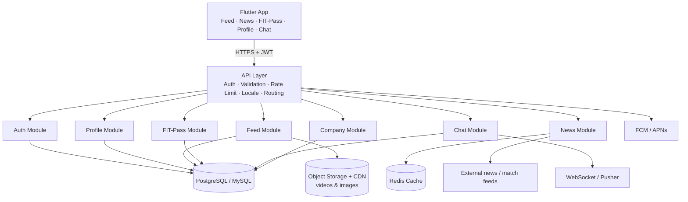
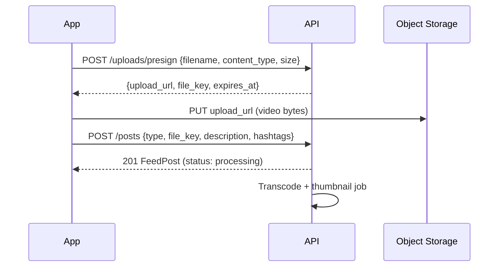
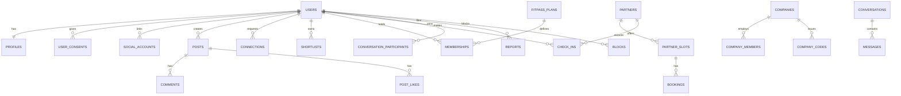

# Sportify — Backend API Contract (Phase 1)

> **Audience:** Backend developer(s).
> **Author:** Mobile team (Flutter).
> **Status:** Draft v1.0 — derived directly from what the mobile app already renders using mock data sources.

The Flutter app is **fully built against mock data sources**. Every screen, loading state, error state and empty state already works. This document describes **exactly which HTTP requests the app will make**, the **JSON it expects**, and **what the backend must create** (tables, rules, jobs) to serve them.

When an endpoint below goes live, the mobile team only replaces the body of one `*RemoteDataSourceImpl` class — no UI changes.

---

## Table of Contents

1. [Architecture Overview](#1-architecture-overview)
2. [Global Conventions](#2-global-conventions)
3. [Auth & Account (GDPR)](#3-auth--account-gdpr)
4. [Profile & Connections](#4-profile--connections)
5. [Feed / Highlights](#5-feed--highlights)
6. [Player Scouting Profile (7 tabs)](#6-player-scouting-profile-7-tabs)
7. [FIT-Pass](#7-fit-pass)
8. [News, Transfers & Matches](#8-news-transfers--matches)
9. [Chat](#9-chat)
10. [Company / HR Portal](#10-company--hr-portal)
11. [Notifications & Devices](#11-notifications--devices)
12. [Database Schema Summary](#12-database-schema-summary)
13. [Endpoint Checklist](#13-endpoint-checklist)

---

## 1. Architecture Overview



> [!TIP]
> These "modules" can live inside **one backend application** (modular monolith, e.g. Laravel / NestJS / Django). Microservices are not needed for Phase 1.

### What the API Layer must do (applies to every request)

| Responsibility | Requirement |
|---|---|
| **Authentication** | Validate `Authorization: Bearer <JWT>`; reject with `401` |
| **Request validation** | Return `422` with field errors (format in §2.4) |
| **Rate limiting** | e.g. 60 req/min per user, 10 req/min on `/auth/*` |
| **Locale** | Read `Accept-Language: en | de | ar` and localize text content |
| **Routing / versioning** | All routes prefixed with `/api/v1` |
| **CORS** | Allow the GitHub Pages demo origin for web builds |

---

## 2. Global Conventions

### 2.1 Base URL

```
https://<api-host>/api/v1
```

Configured in the app at [`lib/core/constants/api_constants.dart`](../lib/core/constants/api_constants.dart).

### 2.2 Headers sent by the app

```http
Authorization: Bearer <access_token>
Accept: application/json
Content-Type: application/json
Accept-Language: en        # en | de | ar
X-App-Version: 0.1.0
X-Platform: android        # android | ios | web
```

### 2.3 Naming & formats

- JSON keys: **`snake_case`** (the app's parsers accept both `snake_case` and `camelCase`).
- IDs: strings (UUID recommended).
- Dates: ISO-8601 UTC — `2026-11-01T12:00:00Z`.
- Money: object `{ "amount": 25000000, "currency": "EUR" }` — amount in **minor units or whole euros, but be consistent** (whole euros recommended for market values).

### 2.4 Error format (all endpoints)

```json
{
  "message": "The given data was invalid.",
  "errors": {
    "email": ["This email is already taken."]
  }
}
```

| Status | Meaning | How the app reacts |
|---|---|---|
| `400` | Bad request | Generic error toast |
| `401` | Missing/expired token | Tries `/auth/refresh`, else logs out |
| `403` | Forbidden (role/plan) | "Not allowed" / upgrade-plan sheet |
| `404` | Not found | Empty state |
| `409` | Conflict (already liked, slot taken) | Specific toast |
| `422` | Validation | Field errors under inputs |
| `429` | Rate limited | "Try again later" |
| `5xx` | Server error | Retry view |

### 2.5 Pagination (cursor-based)

Request: `?cursor=<opaque>&limit=20`

```json
{
  "data": [ ... ],
  "meta": { "next_cursor": "eyJpZCI6IjEyMyJ9", "has_more": true }
}
```

The app stops loading when `has_more == false`.

### 2.6 Guest mode

Endpoints marked **🌐 Public** must work **without** a token (guest browsing of Feed, News, FIT-Pass partners). Endpoints marked **🔒 Auth** return `401`, and the app shows the sign-in sheet.

---

## 3. Auth & Account (GDPR)

Mobile source: [`auth_remote_data_source.dart`](../lib/features/auth/data/data_sources/auth_remote_data_source.dart), [`login_page.dart`](../lib/features/auth/presentation/pages/login_page.dart), [`register_page.dart`](../lib/features/auth/presentation/pages/register_page.dart), [`auth_modals.dart`](../lib/features/auth/presentation/widgets/auth_modals.dart)

### User object (returned by every auth endpoint)

```json
{
  "user": {
    "id": "u_123",
    "email": "player@sportify.de",
    "role": "player",
    "first_name": "Mustafa",
    "last_name": "Ammar",
    "avatar_url": "https://cdn.sportify.de/avatars/u_123.jpg",
    "locale": "en",
    "email_verified": true,
    "company_id": null
  },
  "access_token": "eyJhbGciOi...",
  "refresh_token": "def50200...",
  "expires_in": 3600
}
```

`role` ∈ `player | coach | club | scout | agent | fan | company_hr`

### 3.1 Register — 🌐 Public
`POST /auth/register` · Screen: Register (3 steps: Role → Details → Consent)

```json
{
  "email": "player@sportify.de",
  "password": "secret123",
  "role": "player",
  "first_name": "Mustafa",
  "last_name": "Ammar",
  "locale": "en",
  "company_code": "ACME-2026",
  "role_details": {
    "position": "CM",
    "club_name": "FC Berlin U19",
    "license_number": null,
    "agency_name": null
  },
  "consents": {
    "terms": true,
    "privacy": true,
    "marketing": false,
    "data_processing": true,
    "version": "2026-10"
  }
}
```

Responses: `201` → User object · `422` (e.g. email taken, terms not accepted)

**Backend must create**
- `users` table (id, email unique, password_hash, role, first_name, last_name, locale, email_verified_at, company_id, deleted_at)
- `user_consents` table (user_id, type, granted, version, ip, user_agent, created_at) — **required by GDPR as proof of consent**
- `role_details` stored in `profiles` (JSON column or role-specific tables)
- Validate `company_code` → attach `company_id` and FIT-Pass plan
- Send verification email

### 3.2 Login with email — 🌐 Public
`POST /auth/login`

```json
{ "email": "player@sportify.de", "password": "secret123", "device_name": "Pixel 8" }
```

`200` → User object · `401` `{ "message": "Invalid email or password." }`

### 3.3 Social login — 🌐 Public
`POST /auth/social/{provider}` · `provider` ∈ `google | apple | facebook | tiktok`

The app obtains a token from the provider SDK on-device and sends it:

```json
{
  "id_token": "<google/apple id token>",
  "access_token": "<facebook/tiktok access token>",
  "role": "player",
  "first_name": "Mustafa",
  "last_name": "Ammar"
}
```

`200` → User object (+ `"is_new_user": true` if account was just created, so the app shows role onboarding)

**Backend must create**
- `social_accounts` table (user_id, provider, provider_user_id, email)
- Verify token server-side with Google / Apple / Facebook / TikTok APIs — **never trust the client**

### 3.4 Refresh token — 🌐 Public
`POST /auth/refresh` · `{ "refresh_token": "..." }` → new `access_token` + `refresh_token`

### 3.5 Logout — 🔒 Auth
`POST /auth/logout` → `204` (revoke refresh token + device push token)

### 3.6 Current user — 🔒 Auth
`GET /auth/me` → User object (used on app start to restore session)

### 3.7 Forgot / reset password — 🌐 Public
- `POST /auth/password/forgot` · `{ "email": "..." }` → `204` (always 204, don't leak whether email exists)
- `POST /auth/password/reset` · `{ "token": "...", "email": "...", "password": "..." }` → `204`

### 3.8 Email verification
- `POST /auth/email/resend` 🔒 → `204`
- `GET /auth/email/verify/{id}/{hash}` (link in email) → redirect to app deep link

### 3.9 Redeem company FIT-Pass code — 🔒 Auth
`POST /auth/company-code` · `{ "code": "ACME-2026" }`

```json
{ "company": { "id": "c_1", "name": "ACME GmbH" }, "plan": { "id": "silver", "name": "Silver" } }
```

`404` invalid code · `409` code exhausted

### 3.10 GDPR data export (Art. 20) — 🔒 Auth
`POST /account/export` → `202 { "message": "Export link will be emailed." }`

**Backend must create:** queued job that zips all user data (profile, posts, messages, bookings, consents) as JSON and emails a signed, expiring link.

### 3.11 Delete account (Art. 17 — App Store / Google Play requirement) — 🔒 Auth
`DELETE /account` · `{ "password": "secret123", "reason": "optional" }` → `204`

**Backend must:** soft-delete immediately, revoke tokens, hard-delete / anonymize personal data within 30 days, delete media from storage.

### 3.12 Update consents — 🔒 Auth
`PUT /account/consents` · `{ "marketing": true, "version": "2026-10" }` → `200`

---

## 4. Profile & Connections

Mobile source: [`profile_remote_data_source.dart`](../lib/features/profile/data/data_sources/profile_remote_data_source.dart), [`profile_edit_sheet.dart`](../lib/features/profile/presentation/widgets/profile_edit_sheet.dart), [`profile_network_sheet.dart`](../lib/features/profile/presentation/widgets/profile_network_sheet.dart)

### Profile object

```json
{
  "id": "prof_1",
  "user_id": "u_123",
  "role": "player",
  "first_name": "Mustafa",
  "last_name": "Ammar",
  "avatar_url": "https://cdn.../avatar.jpg",
  "cover_url": "https://cdn.../cover.jpg",
  "bio": {
    "en": "Box-to-box midfielder...",
    "de": "Box-to-Box-Mittelfeldspieler...",
    "ar": "لاعب وسط..."
  },
  "position": "CM",
  "nationality": "Germany",
  "preferred_foot": "Right",
  "height_cm": 180,
  "weight_kg": 75,
  "date_of_birth": "2005-04-12",
  "current_club": "FC Berlin U19",
  "is_available_for_transfer": true,
  "video_links": [
    { "id": "v1", "platform": "youtube", "url": "https://youtube.com/watch?v=...", "title": "Season highlights" },
    { "id": "v2", "platform": "tiktok", "url": "https://tiktok.com/@.../video/..." }
  ],
  "stats": { "followers": 1240, "following": 310, "connections": 87, "profile_views_30d": 532 },
  "fitpass": { "active_plan": "silver", "check_ins_used": 8, "check_ins_quota": 12 }
}
```

`platform` ∈ `youtube | vimeo | tiktok | instagram | facebook | other`

| # | Method & Path | Auth | Screen / Trigger | Notes |
|---|---|---|---|---|
| 4.1 | `GET /profiles/me` | 🔒 | Profile tab opens | Profile object |
| 4.2 | `PUT /profiles/me` | 🔒 | Edit Profile → Save | Partial update, returns Profile |
| 4.3 | `GET /profiles/{userId}` | 🌐 | Tap any user | Public subset (no email) |
| 4.4 | `POST /profiles/me/avatar` | 🔒 | Change avatar | `multipart/form-data` field `file` → `{ "avatar_url": "..." }` |
| 4.5 | `POST /profiles/me/cover` | 🔒 | Change cover | same as avatar |
| 4.6 | `POST /profiles/me/videos` | 🔒 | Add video link | `{ "url": "...", "title": "..." }` — backend detects `platform` |
| 4.7 | `DELETE /profiles/me/videos/{id}` | 🔒 | Remove video | `204` |
| 4.8 | `POST /users/{id}/follow` / `DELETE` | 🔒 | Follow button | `{ "following": true, "followers": 1241 }` |
| 4.9 | `GET /connections?status=accepted` | 🔒 | My Scouting Network | paginated list of mini-profiles |
| 4.10 | `GET /connections/requests` | 🔒 | Pending requests badge | incoming requests |
| 4.11 | `POST /connections` | 🔒 | Connect | `{ "user_id": "u_9", "message": "Hi..." }` |
| 4.12 | `POST /connections/{id}/accept` | 🔒 | Accept | `200` |
| 4.13 | `POST /connections/{id}/decline` | 🔒 | Decline | `204` |
| 4.14 | `DELETE /connections/{id}` | 🔒 | Remove connection | `204` |

**Backend must create**
- `profiles` (user_id FK, bio_en, bio_de, bio_ar, position, nationality, preferred_foot, height_cm, weight_kg, dob, current_club, available_for_transfer, avatar_path, cover_path, role_details JSON)
- `profile_videos` (profile_id, platform, url, title, thumbnail_url, sort_order)
- `follows` (follower_id, followed_id, unique pair)
- `connections` (requester_id, addressee_id, status `pending|accepted|declined`, message, timestamps)
- Image resizing (thumbnails) on upload

---

## 5. Feed / Highlights

Mobile source: [`feed_remote_data_source.dart`](../lib/features/feed/data/data_sources/feed_remote_data_source.dart), [`feed_post.dart`](../lib/features/feed/domain/entities/feed_post.dart), [`feed_interaction_sheets.dart`](../lib/features/feed/presentation/widgets/feed_interaction_sheets.dart), [`feed_upload_sheet.dart`](../lib/features/feed/presentation/widgets/feed_upload_sheet.dart)

### FeedPost object (the app already parses this exact shape)

```json
{
  "id": "post_1",
  "type": "highlight",
  "author_id": "u_55",
  "author_name": "Jonas Weber",
  "author_avatar": "https://cdn.../a.jpg",
  "video_url": "https://cdn.../clip.mp4",
  "thumbnail_url": "https://cdn.../thumb.jpg",
  "description": "Last-minute winner vs Hertha U19 ⚽ #striker #finishing",
  "hashtags": ["striker", "finishing"],
  "position_code": "ST",
  "position_full": "Striker",
  "jersey_number": 9,
  "age": 19,
  "nationality": "Germany",
  "country_code": "DE",
  "country_flag": "🇩🇪",
  "availability_status": "Available",
  "club_name": "FC Berlin U19",
  "club_city": "Berlin",
  "league_name": "U19 Bundesliga",
  "club_country": "Germany",
  "competition_level": "Youth",
  "division": "1st division",
  "market_value": "€1.2M",
  "preferred_foot": "Left",
  "height_cm": 184,
  "languages": ["German", "English"],
  "goals": 14, "assists": 6, "appearances": 22, "minutes_played": 1780,
  "fit_score": 88, "ai_rating": 91,
  "likes_count": 342,
  "comments_count": 28,
  "is_liked": false,
  "is_shortlisted": false,
  "created_at": "2026-10-30T18:20:00Z"
}
```

`type` ∈ `highlight | workout` (workout = FIT-Pass workout post)

| # | Method & Path | Auth | Screen / Trigger | Request / Response |
|---|---|---|---|---|
| 5.1 | `GET /feed?cursor=&limit=10&hashtag=&position=` | 🌐 | Feed tab, pull-to-refresh, infinite scroll, tap hashtag | paginated `FeedPost[]` |
| 5.2 | `GET /posts/{id}` | 🌐 | Deep link to post | `FeedPost` |
| 5.3 | `POST /posts/{id}/like` | 🔒 | Tap ❤️ | `{ "liked": true, "likes_count": 343 }` |
| 5.4 | `DELETE /posts/{id}/like` | 🔒 | Un-like | same shape |
| 5.5 | `GET /posts/{id}/comments?cursor=` | 🌐 | Open comments sheet | paginated `{ id, author: {id,name,avatar_url}, text, created_at }` |
| 5.6 | `POST /posts/{id}/comments` | 🔒 | Send comment | `{ "text": "Great finish!" }` → comment |
| 5.7 | `DELETE /comments/{id}` | 🔒 | Delete own comment | `204` |
| 5.8 | `POST /uploads/presign` | 🔒 | `+ Post` → pick video | see below |
| 5.9 | `POST /posts` | 🔒 | `+ Post` → Publish | see below |
| 5.10 | `DELETE /posts/{id}` | 🔒 | Delete own post | `204` |
| 5.11 | `POST /posts/{id}/report` | 🔒 | Report sheet | `{ "reason": "spam|abuse|nudity|fake|other", "details": "" }` → `202` |
| 5.12 | `POST /users/{id}/block` / `DELETE` | 🔒 | Block user | `204` — blocked users' posts must disappear from feed |
| 5.13 | `POST /posts/{id}/share` | 🌐 | Share | `{ "share_url": "https://sportify.de/p/post_1" }` (also increments counter) |
| 5.14 | `GET /hashtags/trending` | 🌐 | Feed header chips | `[{ "tag": "striker", "count": 1203 }]` |

### Upload flow (direct-to-storage)



`POST /posts` body:

```json
{
  "type": "highlight",
  "file_key": "uploads/u_123/9f2c.mp4",
  "external_url": null,
  "description": "Free-kick training #setpieces",
  "hashtags": ["setpieces"],
  "workout": { "duration_min": 45, "calories": 420, "venue_id": "p_3" }
}
```

**Backend must create**
- `posts` (id, author_id, type, media_path, thumbnail_path, external_url, description, status `processing|ready|removed`, likes_count, comments_count, shares_count, created_at)
- `post_hashtags` / `hashtags`
- `post_likes` (user_id, post_id, **unique**) → increment/decrement counters atomically
- `comments` (post_id, user_id, text, deleted_at)
- `reports` (reporter_id, target_type, target_id, reason, details, status) + an **admin moderation queue** (store requirement for UGC apps)
- `blocks` (blocker_id, blocked_id)
- Video transcoding (HLS / MP4 720p) + thumbnail generation job
- Feed ranking query: newest first, exclude blocked users, filter by hashtag/position

---

## 6. Player Scouting Profile (7 tabs)

Mobile source: [`player_profile_page.dart`](../lib/features/feed/presentation/pages/player_profile_page.dart), [`player_scouting_profile.dart`](../lib/features/feed/domain/entities/player_scouting_profile.dart)

Tabs: **Overview · Statistics · Highlights · Gallery · Career · Market · AI Analysis**

> One aggregate call keeps the screen fast. Optional per-tab calls let you lazy-load heavy tabs.

| # | Method & Path | Auth | Tab |
|---|---|---|---|
| 6.1 | `GET /players/{id}` | 🌐 | Header + Overview (bio, traits, current club, transfer wishes) |
| 6.2 | `GET /players/{id}/stats?season=2025-26` | 🌐 | Statistics (season stats + radar) |
| 6.3 | `GET /players/{id}/highlights` | 🌐 | Highlights (clips) |
| 6.4 | `GET /players/{id}/gallery` | 🌐 | Gallery (photos) |
| 6.5 | `GET /players/{id}/career` | 🌐 | Career (clubs timeline, honours, injuries) |
| 6.6 | `GET /players/{id}/market` | 🌐 | Market (value history, contract, interest) |
| 6.7 | `GET /players/{id}/ai-analysis` | 🔒 | AI Analysis (strengths, weaknesses, comparable players) |
| 6.8 | `POST /shortlist` / `DELETE /shortlist/{playerId}` | 🔒 | ⭐ Shortlist button (scouts/clubs/agents) |
| 6.9 | `GET /shortlist` | 🔒 | Scout's shortlist |

Key nested objects (already parsed by the app):

```json
{
  "radar_stats": { "pace": 82, "shooting": 76, "passing": 84, "dribbling": 80, "defending": 61, "physical": 74 },
  "transfer_wishes": [
    { "club_name": "Borussia Dortmund", "initials": "BVB", "country": "Germany", "league": "Bundesliga", "tier": "Top", "badge_color_hex": 4294956800 }
  ],
  "market_value_history": [ { "date": "2025-07-01", "value": 800000, "label": "€0.8M" } ],
  "highlights": [ { "id": "h1", "title": "Hat-trick vs ...", "video_url": "...", "thumbnail_url": "...", "duration_sec": 74, "views": 1200 } ]
}
```

**Backend must create**
- `player_season_stats` (player_id, season, competition, goals, assists, appearances, minutes, cards, radar fields)
- `career_entries` (player_id, club, from, to, appearances, goals, type `permanent|loan|youth`)
- `market_values` (player_id, date, value_eur)
- `player_media` (gallery photos)
- `shortlists` (owner_id, player_id, note, unique pair) — restricted to roles `scout | club | agent | coach`
- AI analysis: start as a **cached JSON field per player** generated by a scheduled job (LLM or rules); `fit_score` & `ai_rating` live here

---

## 7. FIT-Pass

Mobile source: [`fitpass_remote_datasource.dart`](../lib/features/fitpass/data/datasources/fitpass_remote_datasource.dart), [`fitpass_booking_and_training.dart`](../lib/features/fitpass/presentation/widgets/fitpass_booking_and_training.dart), [`fitpass_digital_card.dart`](../lib/features/fitpass/presentation/widgets/fitpass_digital_card.dart)

### Objects

```json
// Plan
{ "id": "silver", "name": "Silver", "category": "individual", "price": 39.0, "price_yearly": 390.0,
  "currency": "EUR", "check_ins_per_month": 12, "features": ["300+ gyms", "Online courses"], "is_popular": true }

// Partner
{ "id": "p_1", "name": "Berlin Elite Gym", "type": "Gym", "address": "Alexanderplatz 1, Berlin",
  "latitude": 52.5219, "longitude": 13.4132, "distance_km": 1.2, "image_url": "...", "rating": 4.7,
  "amenities": ["Sauna", "Pool"], "opening_hours": { "mon": "06:00-23:00" }, "min_plan": "bronze" }
```

| # | Method & Path | Auth | Screen / Trigger | Notes |
|---|---|---|---|---|
| 7.1 | `GET /fitpass/plans?category=individual` | 🌐 | Plans tab | `Plan[]` |
| 7.2 | `GET /fitpass/partners?lat=52.52&lng=13.40&radius_km=10&type=Gym&q=` | 🌐 | Venues & Map tab | paginated `Partner[]`, sorted by distance |
| 7.3 | `GET /fitpass/partners/{id}` | 🌐 | Partner detail | Partner + photos |
| 7.4 | `GET /fitpass/membership` | 🔒 | Digital wallet card | `{ plan, status, valid_until, check_ins_used, check_ins_quota, member_code }` |
| 7.5 | `POST /fitpass/membership` | 🔒 | Activate plan | `{ "plan_id": "gold", "billing": "monthly" }` → membership (payment later) |
| 7.6 | `GET /fitpass/qr-token` | 🔒 | QR sheet | `{ "token": "eyJ...", "expires_at": "...+60s" }` — **rotating, signed, short-lived** |
| 7.7 | `POST /fitpass/check-ins` | 🔒 (partner device) | Partner scans member QR | `{ "token": "...", "partner_id": "p_1" }` → `201` / `403 quota exceeded` |
| 7.8 | `GET /fitpass/check-ins?cursor=` | 🔒 | Check-in history | paginated |
| 7.9 | `GET /fitpass/partners/{id}/slots?date=2026-11-03` | 🌐 | Booking calendar | `[{ "id": "s1", "start": "18:30", "session": "Pro Football Conditioning", "capacity": 12, "booked": 9 }]` |
| 7.10 | `POST /fitpass/bookings` | 🔒 | Confirm booking | `{ "slot_id": "s1" }` → `201` / `409 slot full` |
| 7.11 | `GET /fitpass/bookings?upcoming=true` | 🔒 | Upcoming bookings | list |
| 7.12 | `DELETE /fitpass/bookings/{id}` | 🔒 | Cancel booking | `204` |
| 7.13 | `GET /fitpass/courses` | 🌐 | Training tab | `[{ id, title, coach, duration_min, category, video_url, min_plan, completed }]` |
| 7.14 | `POST /fitpass/courses/{id}/progress` | 🔒 | Mark complete | `{ "completed": true, "position_sec": 0 }` |

**Backend must create**
- `fitpass_plans`, `memberships` (user_id, plan_id, status, valid_from, valid_until, source `self|company`)
- `partners` (+ spatial index on lat/lng for distance queries), `partner_photos`
- `partner_slots` (partner_id, starts_at, session_type, capacity) and `bookings` (user_id, slot_id, status) with a **capacity check inside a transaction**
- `check_ins` (user_id, partner_id, created_at) + monthly quota enforcement
- QR token signing (HMAC/JWT, 60s TTL, single-use)
- `courses`, `course_progress`
- Partner-side scanner endpoint (partner staff account role `partner`)

---

## 8. News, Transfers & Matches

Mobile source: [`news_remote_datasource.dart`](../lib/features/news/data/datasources/news_remote_datasource.dart), [`news_hub_page.dart`](../lib/features/news/presentation/pages/news_hub_page.dart), [`news_matches_and_reader.dart`](../lib/features/news/presentation/widgets/news_matches_and_reader.dart)

| # | Method & Path | Auth | Tab / Trigger | Response item |
|---|---|---|---|---|
| 8.1 | `GET /news?category=&cursor=&limit=20` | 🌐 | News tab (localized by `Accept-Language`) | `{ id, title, summary, source, url, image_url, published_at, category }` |
| 8.2 | `GET /news/{id}` | 🌐 | Article reader sheet | above + `body_html`, `related_player_ids`, `related_club_ids` |
| 8.3 | `GET /transfers?status=&q=&cursor=` | 🌐 | Transfers tab (search + stage chips) | `{ id, player_id, player_name, position, from_club, to_club, status, fee, date, source, reliability }` |
| 8.4 | `GET /transfers/summary` | 🌐 | Transfer hero header | `{ "active_moves": 120, "total_volume_eur": 845000000, "confirmed": 38, "top": [...] }` |
| 8.5 | `GET /matches?date=2026-11-01&league=bundesliga` | 🌐 | Matches tab | see below |
| 8.6 | `GET /matches/{id}` | 🌐 | Match detail | events, lineups |
| 8.7 | `GET /leagues` | 🌐 | League filter chips | `[{ id, name, country, logo_url }]` |

Transfer `status` ∈ `rumour | negotiating | advanced | here_we_go | confirmed | loan`

```json
// Match
{
  "id": "m_1", "league": { "id": "bundesliga", "name": "Bundesliga" },
  "home": { "name": "Bayern München", "short": "FCB", "logo_url": "..." },
  "away": { "name": "Borussia Dortmund", "short": "BVB", "logo_url": "..." },
  "score": { "home": 2, "away": 1 },
  "status": "live", "minute": 78, "kickoff": "2026-11-01T17:30:00Z",
  "motm": { "player_id": "u_77", "name": "Jamal Musiala", "rating": 8.9 }
}
```

`status` ∈ `scheduled | live | ht | ft | postponed`

**Backend must create**
- `news_articles` (with `locale` column, or translations table) — ingested by a **scheduled job** from licensed sources/RSS
- `transfers` (player_id nullable, player_name, clubs, status, fee_eur, source, reliability, date)
- `matches`, `leagues`, `teams` — synced from a football data provider (e.g. API-Football, Sportmonks)
- **Redis cache** (news 5 min, live matches 30 s) — these endpoints are the most called
- Link `player_id` to Sportify profiles where possible (enables "tap → Player Profile")

---

## 9. Chat

Mobile source: [`chat_remote_datasource.dart`](../lib/features/chat/data/datasources/chat_remote_datasource.dart), [`chat_entities.dart`](../lib/features/chat/domain/entities/chat_entities.dart)

| # | Method & Path | Auth | Trigger | Notes |
|---|---|---|---|---|
| 9.1 | `GET /conversations?cursor=` | 🔒 | Chat list | `[{ id, other_participant: {id,name,profile_image_url,is_online}, last_message, unread_count }]` |
| 9.2 | `POST /conversations` | 🔒 | "Message" button on a profile | `{ "user_id": "u_9" }` → existing or new conversation |
| 9.3 | `GET /conversations/{id}/messages?cursor=` | 🔒 | Open thread | `[{ id, sender_id, text, attachment_url, timestamp, is_read }]` newest first |
| 9.4 | `POST /conversations/{id}/messages` | 🔒 | Send | `{ "text": "Hello", "attachment_key": null, "client_id": "tmp_1" }` |
| 9.5 | `POST /conversations/{id}/read` | 🔒 | Thread visible | marks all as read |
| 9.6 | WebSocket `private-user.{id}` | 🔒 | Real-time | events: `message.created`, `message.read`, `typing` |

**Backend must create**
- `conversations`, `conversation_participants` (with `last_read_message_id`), `messages`
- Real-time broadcasting (Laravel Reverb / Pusher / Socket.IO / Firebase)
- Push notification when recipient is offline
- Rule: users who **blocked** each other cannot message

---

## 10. Company / HR Portal

Mobile source: `lib/features/company/` (UI built; data layer pending)

| # | Method & Path | Auth (role `company_hr`) | Trigger |
|---|---|---|---|
| 10.1 | `GET /company` | 🔒 | Portal header (name, plan, seats used/total) |
| 10.2 | `GET /company/employees?cursor=&q=` | 🔒 | Employees tab |
| 10.3 | `POST /company/employees/invite` | 🔒 | `{ "emails": ["a@acme.de"], "plan_id": "silver" }` |
| 10.4 | `PATCH /company/employees/{id}` | 🔒 | Change plan / deactivate |
| 10.5 | `DELETE /company/employees/{id}` | 🔒 | Remove employee |
| 10.6 | `POST /company/codes` | 🔒 | Generate invite code `{ "max_uses": 50, "expires_at": "..." }` |
| 10.7 | `GET /company/usage?period=2026-10` | 🔒 | Usage charts (check-ins per week, active employees) |
| 10.8 | `GET /company/invoices` | 🔒 | Invoices list |
| 10.9 | `GET /company/invoices/{id}/pdf` | 🔒 | Download PDF (signed URL) |

**Backend must create:** `companies`, `company_members`, `company_codes`, `invoices`, aggregated usage queries (from `check_ins`), PDF generation.

---

## 11. Notifications & Devices

| # | Method & Path | Auth | Purpose |
|---|---|---|---|
| 11.1 | `POST /devices` | 🔒 | `{ "token": "<fcm token>", "platform": "android" }` register push token |
| 11.2 | `DELETE /devices/{token}` | 🔒 | on logout |
| 11.3 | `GET /notifications?cursor=` | 🔒 | In-app notifications list |
| 11.4 | `POST /notifications/read-all` | 🔒 | Clear badge |
| 11.5 | `PUT /notifications/preferences` | 🔒 | `{ "likes": true, "comments": true, "transfers": true, "matches": false }` |

Push payload must include `{ "type": "comment|like|connection|message|booking|transfer", "target_id": "..." }` so the app opens the correct screen.

---

## 12. Database Schema Summary



---

## 13. Endpoint Checklist

Priority **P0** = needed for the app to work end-to-end, **P1** = core Phase 1, **P2** = can follow.

| Module | Endpoints | Priority |
|---|---|---|
| Auth | register, login, refresh, me, logout | **P0** |
| Auth | social (4 providers), forgot/reset, verify email, company code | P1 |
| Account | export (Art. 20), delete (Art. 17), consents | **P0** (store requirement) |
| Profile | me get/update, public profile, avatar/cover, video links | **P0** |
| Connections / Follow | 7 endpoints | P1 |
| Feed | list, like/unlike, comments, upload + post, report, block | **P0** (report/block = store requirement) |
| Player profile | aggregate + 6 tabs, shortlist | P1 |
| FIT-Pass | plans, partners, membership, QR + check-in | **P0** |
| FIT-Pass | slots, bookings, courses | P1 |
| News | news, article, transfers, summary | P1 |
| Matches | matches, match detail, leagues | P2 |
| Chat | 5 REST + WebSocket | P1 |
| Company | 9 endpoints | P2 |
| Notifications | devices, list, preferences | P1 |

**Total: ~75 endpoints.** Machine-readable spec: [`openapi.yaml`](./openapi.yaml).

